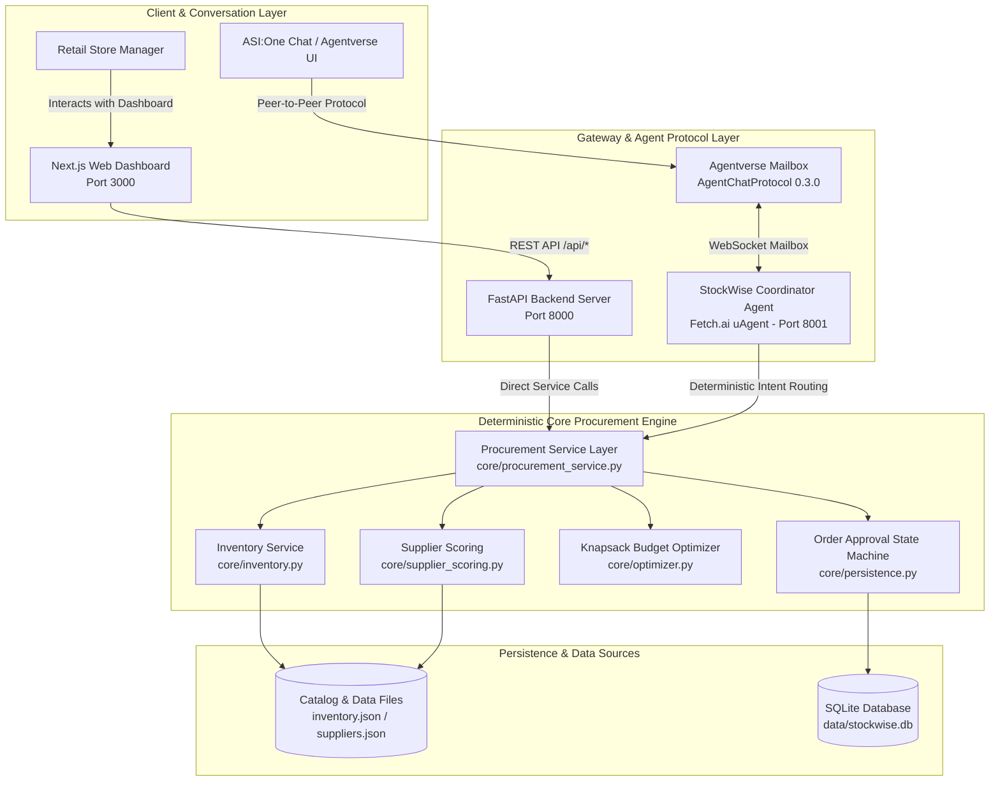
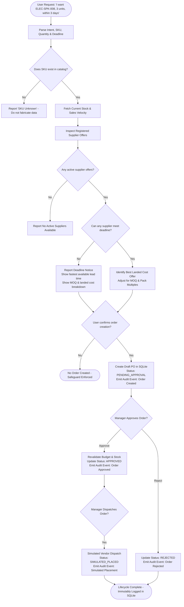
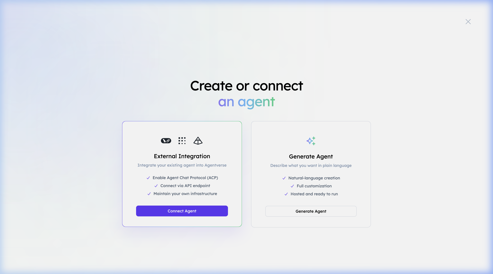
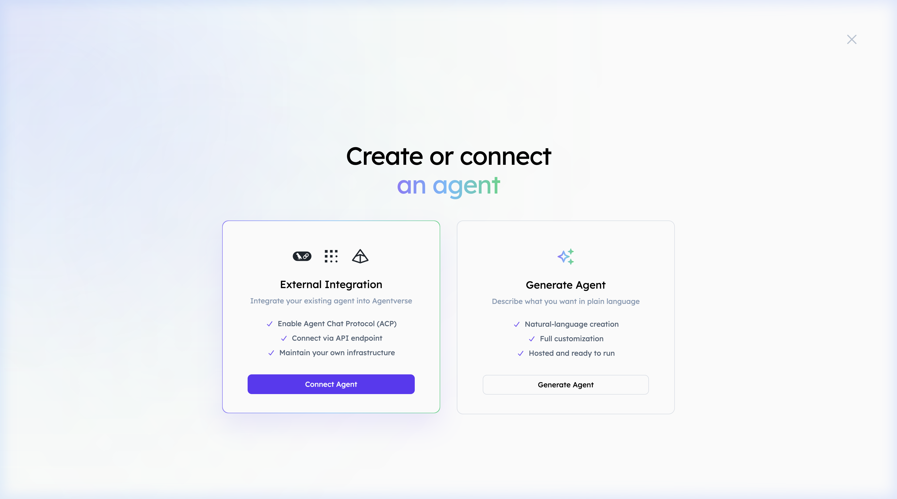
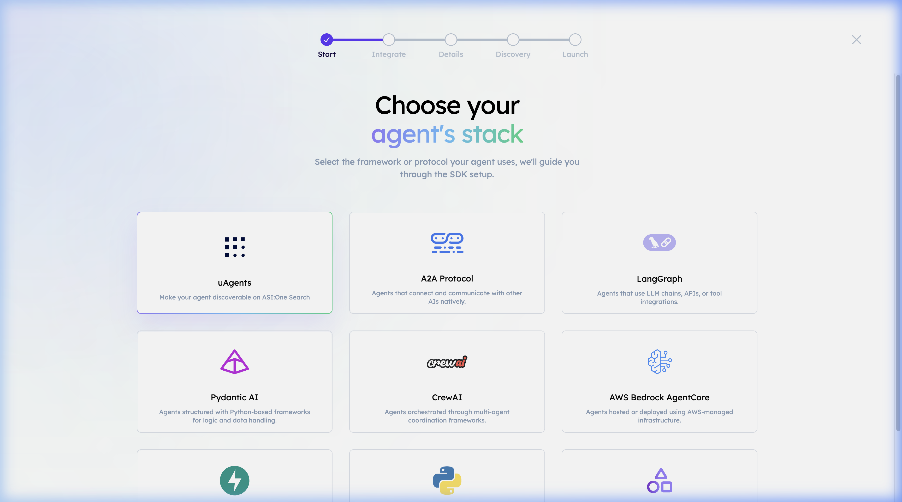
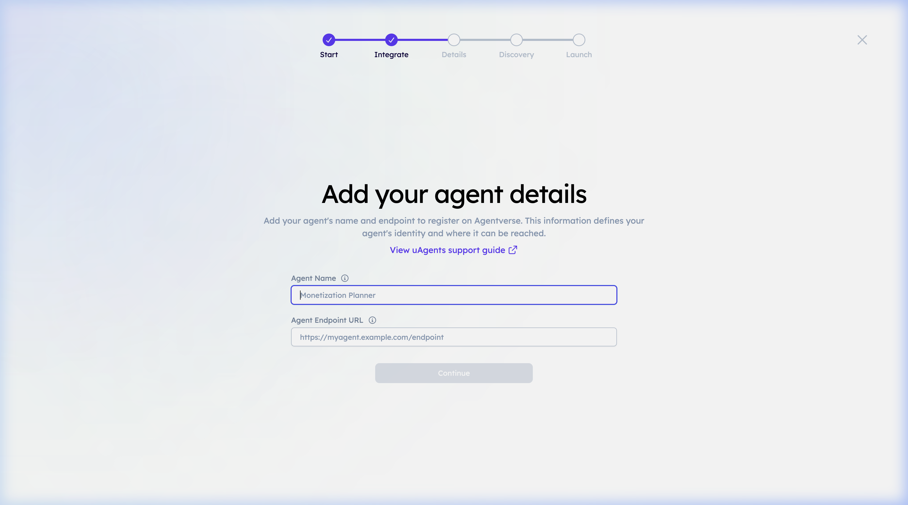
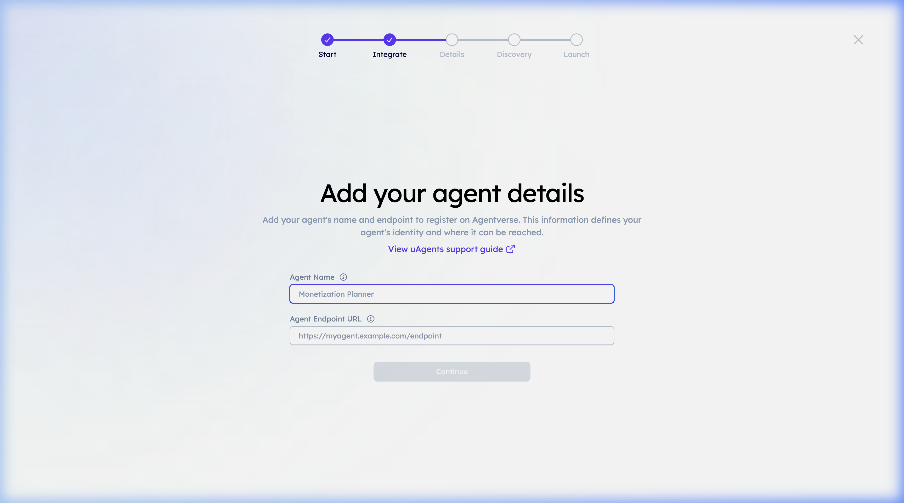
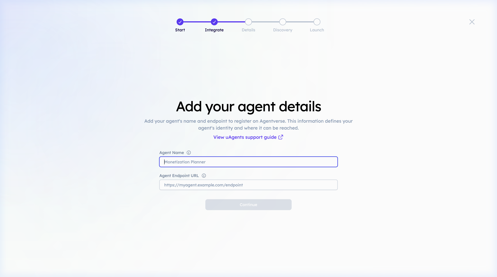

# StockWise Agents


> **Autonomous retail inventory replenishment and procurement coordination agent powered by Fetch.ai uAgents, AgentChatProtocol, official ASI Interactive Cards, and deterministic mathematical optimization.**

---

## 📑 Table of Contents
1. [Introduction](#-introduction)
2. [Problem Statement](#-problem-statement)
3. [Solution & Key Features](#-solution--key-features)
4. [System Architecture](#-system-architecture)
5. [End-to-End Workflow Diagram](#-end-to-end-workflow-diagram)
6. [Technology Stack](#-technology-stack)
7. [Repository Structure](#-repository-structure)
8. [Prerequisites](#-prerequisites)
9. [Installation & Setup](#-installation--setup)
10. [Usage Guide](#-usage-guide)
11. [Realistic Procurement Scenario](#-realistic-procurement-scenario)
12. [Testing & Verification](#-testing--verification)
13. [Security & Limitations](#-security--limitations)
14. [Product Roadmap](#-product-roadmap)
15. [Contributing & License](#-contributing--license)
16. [Screenshots & UI Showcase](#-screenshots--ui-showcase)

---

## 🌟 Introduction

**StockWise Agents** is an open-source, autonomous procurement management agent designed for small-to-medium retail businesses. Built on the **Fetch.ai uAgents** framework (`0.25.5`) and implementing the official **AgentChatProtocol** (`0.3.0`), StockWise bridges the gap between daily inventory monitoring and complex multi-vendor purchasing.

Instead of relying on guesswork, spreadsheets, or black-box LLM estimations, StockWise employs a deterministic procurement engine:
- **Analyzes live stock levels** against daily burn rates and lead times to detect shortages.
- **Ranks supplier offers** through multi-criteria scoring balancing unit cost, lead time, MOQ, and pack size multiples.
- **Optimizes restocking plans** via a budget-constrained knapsack algorithm that maximizes inventory coverage under a hard financial ceiling in INR (₹).
- **Enforces strict human-in-the-loop governance** through a transactional SQLite state machine requiring explicit manager approval before simulated order placement.

---

## 📌 Problem Statement

Small independent retailers face substantial operational friction when managing inventory:
- **Costly Stockouts**: Running out of fast-moving products results in direct revenue loss, reduced customer retention, and damaged seller ratings.
- **Overbuying & Dead Stock**: Purchasing without strict budget caps or minimum order quantity (MOQ) optimization ties up precious working capital in slow-moving inventory.
- **Vendor Fragmentation**: Juggling dozens of supplier catalogs with differing wholesale price tiers, lead times, pack size constraints, and flat delivery fees is time-consuming and prone to human error.
- **Lack of Purchasing Governance**: Ad-hoc purchases made across text messages or verbal agreements lack validation, audit trails, and multi-step approval workflows.

---

## 💡 Solution & Key Features

StockWise Agents replaces manual inventory reordering with an autonomous, transparent procurement pipeline:

| Feature | Implementation Component | Evidence / Test Coverage | Status |
| :--- | :--- | :--- | :--- |
| **Inventory Health Analysis** | `core/inventory.py` | `tests/test_inventory.py` | ✅ Production Ready |
| **Multi-Supplier Composite Scoring** | `core/supplier_scoring.py` | `tests/test_optimizer.py` | ✅ Production Ready |
| **Budget-Constrained Knapsack Optimizer** | `core/optimizer.py` | `tests/test_optimizer.py` | ✅ Production Ready |
| **Purchase Order State Machine** | `core/persistence.py` | `tests/test_persistence.py` | ✅ Production Ready |
| **Single-Item Natural Language Procurement** | `agents/coordinator.py`, `core/procurement_service.py` | `tests/test_single_item_request.py` | ✅ Production Ready |
| **Conversational Health & Shortage Queries** | `agents/coordinator.py` | `tests/test_inventory_chat_queries.py` | ✅ Production Ready |
| **FastAPI REST Backend** | `agents/api_server.py` | `tests/test_api_server.py` | ✅ Production Ready |
| **Next.js Web Dashboard** | `frontend/src/` | `npm run build` (Clean build) | ✅ Production Ready |
| **Autonomous Supplier Failure Recovery** | `core/procurement_service.py` | `tests/test_supplier_failure.py` | ✅ Production Ready |
| **ASI Interactive Cards (Drawer UI)** | `agents/cards.py`, `agents/coordinator.py` | `tests/test_interactive_cards.py` | ✅ Production Ready |
| **Fetch.ai uAgents Protocol (ACP 0.3.0)** | `agents/coordinator.py` | `tests/test_coordinator_protocol.py` | ✅ Production Ready |
| **Agentverse Mailbox Discovery** | `agents/coordinator.py` | Mailbox registration in logs | ✅ Production Ready |
| **ASI:One LLM Conversational Fallback** | `agents/coordinator.py` | Direct API test via `asi1-mini` | ⚠️ Available (Requires API Key) |

---

## ⚙️ System Architecture

StockWise Agents uses a decoupled, service-oriented architecture connecting an interactive Next.js web application, a FastAPI REST gateway, an autonomous Fetch.ai uAgent, and deterministic mathematical optimization services.



---

## 🔄 End-to-End Workflow Diagram

The flowchart below demonstrates the decision pipeline when a user submits an inventory inquiry, single-item procurement request, or bulk restocking query.



---

## 💻 Technology Stack

| Layer | Technology | Version | Purpose in StockWise Agents |
| :--- | :--- | :--- | :--- |
| **Agent Framework** | [Fetch.ai uAgents](https://github.com/fetchai/uAgents) | `0.25.5` | Autonomous agent lifecycle, address generation, protocol handling |
| **Agent Protocol** | `AgentChatProtocol` | `0.3.0` | Official Fetch.ai specification for messaging across Agentverse & ASI:One |
| **Backend REST API** | [FastAPI](https://fastapi.tiangolo.com/) | `0.115.0` | High-throughput asynchronous REST gateway for web frontend |
| **ASGI Server** | [Uvicorn](https://www.uvicorn.org/) | `0.30.0` | Production ASGI web server running the FastAPI application |
| **Data Validation** | [Pydantic](https://docs.pydantic.dev/) | `2.10.0` | Strict schema validation, type enforcement, and Decimal serialization |
| **Frontend Framework** | [Next.js](https://nextjs.org/) | `16.4.3` | React 19 App Router frontend with Turbopack |
| **Styling** | [Tailwind CSS](https://tailwindcss.com/) | `4.0` | Enterprise B2B SaaS layout, responsive grid, slate/indigo design system |
| **Icons & Charts** | Lucide React / Recharts | `^1.61` / `^3.10` | Interactive status badges, charts, and metrics |
| **Database** | SQLite 3 | Built-in | Zero-dependency ACID persistence, schema migrations, immutable audit logging |
| **Testing** | [pytest](https://docs.pytest.org/) | `9.1.1` | Comprehensive automated unit, integration, and regression testing |

---

## 📂 Repository Structure

```
StockWise-Agents/
├── README.md                           # Main repository documentation
├── LICENSE                             # Open source MIT license
├── CONTRIBUTING.md                     # Contribution guidelines and setup instructions
├── SECURITY.md                         # Security policy, safeguards, and vulnerability disclosure
├── CHANGELOG.md                        # Version history and release notes
├── .gitignore                          # Git ignore rules (excludes .env, .db, node_modules, .venv)
├── .dockerignore                       # Docker build exclusions
├── .env.example                        # Safe environment variable template with sanitized placeholders
├── Dockerfile                          # Production container image configuration
├── requirements.txt                    # Pinned Python package dependencies
├── agents/
│   ├── __init__.py                     # Module package definition
│   ├── coordinator.py                  # Fetch.ai uAgent coordinator, ACP protocol & intent routing
│   ├── cards.py                        # Official ASI Interactive Cards builders and envelope helpers
│   └── api_server.py                   # FastAPI REST backend connecting web UI to procurement engine
├── core/
│   ├── __init__.py                     # Core module exports
│   ├── inventory.py                    # Stock burn rate, lead time, and requirement calculations
│   ├── optimizer.py                    # Knapsack budget allocation algorithm respecting MOQs & packs
│   ├── persistence.py                  # SQLite database layer, approval state machine & audit events
│   ├── procurement_service.py          # Unified service layer coordinating business logic
│   ├── purchase_orders.py              # Purchase order data structures and summary formatters
│   ├── schemas.py                      # Pydantic v2 data models for products, suppliers, and orders
│   └── supplier_scoring.py             # Multi-supplier composite scoring and feasible quantity logic
├── data/
│   ├── inventory.json                  # Sample retail electronics master catalog (15 SKUs)
│   ├── suppliers.json                  # Registered supplier catalogs (SUP-001 through SUP-004)
│   └── stockwise.db                    # Runtime SQLite database (ignored by git, created on startup)
├── frontend/
│   ├── package.json                    # Node.js dependencies and build scripts
│   ├── tsconfig.json                   # TypeScript compiler configuration
│   ├── next.config.ts                  # Next.js configuration
│   └── src/
│       ├── app/                        # Next.js App Router root layout and main dashboard page
│       ├── components/                 # UI Views: Overview, Inventory, Suppliers, Planner, Orders, Chat
│       ├── lib/                        # API client, number/currency formatters, helper functions
│       └── types/                      # TypeScript interface contracts matching backend Pydantic models
├── tests/
│   ├── __init__.py                     # Test package initializer
│   ├── test_api_server.py              # FastAPI endpoint integration tests
│   ├── test_coordinator_procurement.py # Chat command execution tests
│   ├── test_coordinator_protocol.py    # Fetch.ai protocol specification and message handling tests
│   ├── test_interactive_cards.py       # ASI Interactive Cards wire format, payloads, and lifecycle tests
│   ├── test_inventory.py               # Inventory requirement formulas and urgency classification tests
│   ├── test_inventory_chat_queries.py  # Conversational inventory queries and health summary regression tests
│   ├── test_optimizer.py               # Knapsack budget optimizer and constraint enforcement tests
│   ├── test_persistence.py             # SQLite persistence, state machine, and audit trail tests
│   ├── test_single_item_request.py     # Single-item prompt parsing, MOQ validation, and lead time tests
│   └── test_supplier_failure.py        # Autonomous vendor failure and recalculation tests
├── docs/
│   └── screenshots/                    # Local UI showcase captures referenced in README
└── .github/
    └── workflows/
        └── ci.yml                      # GitHub Actions CI workflow (Pytest + Next.js build)
```

---

## 📋 Prerequisites

To run StockWise Agents locally, ensure your environment meets the following requirements:
- **Operating System**: macOS 12+, Ubuntu 22.04+, or Debian 12+ (Linux/WSL2 supported).
- **Python**: Version `3.12` installed.
- **Node.js**: Version `20.x` or `22.x` with `npm` installed.
- **Git**: Installed and configured.

---

## 🚀 Installation & Setup

Follow these exact steps to run the complete StockWise Agents stack locally:

### 1. Clone the Repository
```bash
git clone https://github.com/<your-username>/stockwise-agents.git
cd stockwise-agents
```

### 2. Set Up Python Virtual Environment
```bash
python3.12 -m venv .venv
source .venv/bin/activate
pip install --upgrade pip
pip install -r requirements.txt
```

### 3. Set Up Next.js Frontend
```bash
cd frontend
npm install
cd ..
```

### 4. Configure Environment Variables
Copy the example environment template:
```bash
cp .env.example .env
```
*(The local deterministic procurement engine, FastAPI server, and Next.js frontend function out of the box with default development values. External ASI:One LLM chat and Agentverse mailbox connectivity can be enabled by supplying your keys in `.env`.)*

### 5. Run Automated Tests
Verify that all 81 unit, integration, and regression tests pass:
```bash
pytest
```

### 6. Start the Services
Open three terminal tabs (or run in background):

**Terminal 1 — FastAPI Backend (Port 8000)**:
```bash
source .venv/bin/activate
uvicorn agents.api_server:app --port 8000
```

**Terminal 2 — Fetch.ai Coordinator Agent (Port 8001)**:
```bash
source .venv/bin/activate
python agents/coordinator.py
```

**Terminal 3 — Next.js Web Dashboard (Port 3000)**:
```bash
cd frontend
npm run dev
```

### 7. Access the Application
- **Web Dashboard**: Open [http://localhost:3000](http://localhost:3000)
- **FastAPI OpenAPI Interactive Docs**: Open [http://127.0.0.1:8000/docs](http://127.0.0.1:8000/docs)
- **Coordinator Agent Inspector**: Displayed in coordinator startup logs (e.g. `http://127.0.0.1:8001`)

---

## 💬 Usage Guide

The **Agent Workspace** tab in the web dashboard or direct calls to `POST /api/chat` support natural-language procurement commands:

### 1. Store Health & Inventory Summaries
- `"Give me a quick summary of my store's inventory health."`  
  *Returns total monitored SKUs, physical stock, reorder shortages, critical shortages, and top priority items.*
- `"Which products are running low?"`  
  *Lists all 13 products currently below target coverage thresholds.*
- `"Which products may run out within three days?"`  
  *Filters products whose estimated runout ($\text{stock} / \text{daily sales}$) is $\le 3$ days.*
- `"What should I restock first?"`  
  *Prioritizes replenishment candidates by composite urgency score (0–100).*

### 2. Single-Product Inquiries
- `"Check inventory for ELEC-SPK-008."`  
  *Displays exact stock status: current stock (6 pieces), safety stock (3 pieces), sales velocity (0.8/day), runout days (7.5d), and reorder shortfall (9 pieces).*
- `"I want ELEC-SPK-008, 3 units, within 3 days"`  
  *Evaluates supplier terms against the deadline. Correctly identifies that Zenith Electronics (`SUP-002`) requires a 4-day lead time (violating the 3-day request) and an MOQ of 4 units, calculating total landed cost at ₹2,780.00.*

### 3. Procurement Planning & Purchasing Workflows
- `"Compare suppliers"`  
  *Ranks available vendors for shortage items by composite score.*
- `"Create restocking plan with budget ₹20,000"`  
  *Executes knapsack optimization, selects best suppliers, respects pack sizes and delivery fees, and persists a draft purchase order in `PENDING_APPROVAL`.*
- `"Approve order PO-XXXXXXXX"`  
  *Revalidates budget and supplier availability, transitioning order from `PENDING_APPROVAL` to `APPROVED` with audit logging.*
- `"Simulate placing order PO-XXXXXXXX"`  
  *Simulates vendor dispatch in demo test mode (`SIMULATED_PLACED`). No physical money or goods are moved.*
- `"Supplier SUP-001 failed"`  
  *Flags vendor as offline, excludes them from scoring, and recalculates replenishment using next-best suppliers.*

---

## 📊 Realistic Procurement Scenario

Below is an actual verified calculation executed by the StockWise procurement engine:

```
STOCKWISE PROCUREMENT PLAN
============================================================
Request ID:         REQ-7A1B2C3D
Order ID:           PO-4E8F90A1
Status:             PENDING_APPROVAL
Authorized Budget:  ₹20,000.00
Selected Suppliers: SUP-004 (RapidExpress Logistics & Wholesale)
Subtotal:           ₹19,705.00
Delivery Charges:   ₹150.00
Total Landed Cost:  ₹19,855.00
Remaining Budget:   ₹145.00
------------------------------------------------------------
ALLOCATED PRODUCTS (3 items):
  1. [ELEC-PWR-002] 20W PD Dual-Port Wall Charger
     Supplier: RapidExpress Logistics (SUP-004) | Lead: 1d
     Qty: 31 units @ ₹315.00/unit = ₹9,765.00
  2. [ELEC-USB-001] Braided USB-C Fast Charging Cable (1m)
     Supplier: RapidExpress Logistics (SUP-004) | Lead: 1d
     Qty: 54 units @ ₹105.00/unit = ₹5,670.00
  3. [ELEC-HUB-013] 4-Port USB 3.0 Ultra-Slim Hub
     Supplier: RapidExpress Logistics (SUP-004) | Lead: 1d
     Qty: 10 units @ ₹410.00/unit = ₹4,100.00
------------------------------------------------------------
DEFERRED PRODUCTS (Budget Cap Enforced):
  1. [ELEC-AUD-003] Wireless TWS Earbuds with ANC (Need: 20 units)
     Reason: Insufficient budget: Lowest feasible offer ₹16,400.00 exceeds remaining budget ₹145.00
============================================================
[NOTE: Synthetic Demo Data - No real order or money transferred]
Next Action: To approve this purchase, say: 'Approve order PO-4E8F90A1'
             To reject, say: 'Reject order PO-4E8F90A1'
```

---

## 🧪 Testing & Verification

StockWise Agents includes automated tests covering every layer of the architecture:

```bash
$ pytest
============================= test session starts ==============================
platform darwin -- Python 3.12.1, pytest-9.1.1, pluggy-1.7.0
rootdir: /Users/udaysaini/Antigravity/stockwise-agents
collected 81 items                                                             

tests/test_api_server.py ........                                        [  9%]
tests/test_coordinator_procurement.py ..............                     [ 27%]
tests/test_coordinator_protocol.py ......                                [ 34%]
tests/test_interactive_cards.py .............                            [ 50%]
tests/test_inventory.py ......                                           [ 58%]
tests/test_inventory_chat_queries.py ...........                         [ 71%]
tests/test_optimizer.py ......                                           [ 79%]
tests/test_persistence.py .......                                        [ 87%]
tests/test_single_item_request.py .......                                [ 96%]
tests/test_supplier_failure.py ...                                       [100%]

======================== 81 passed, 1 warning in 5.78s =========================
```

### Key Invariants Tested:
1. **Mathematical Invariant**: Under no circumstances does total order cost exceed authorized budget.
2. **Pack Size & MOQ Invariant**: All line items strictly satisfy $\text{qty} \ge \text{MOQ}$ and $\text{qty} \pmod{\text{pack\_size}} = 0$.
3. **State Machine Invariant**: Terminal states (`SIMULATED_PLACED`, `REJECTED`) cannot transition to any other status.
4. **Read-Only Safety**: Inventory queries and stock summaries never modify database records or create purchase orders.

---

## 🔒 Security & Limitations

### Security Safeguards
- **Zero Hardcoded Secrets**: All seeds, API keys, and mailbox credentials are read strictly from `.env` (which is excluded from Git tracking via `.gitignore`).
- **Sanitized `.env.example`**: The checked-in template contains only placeholder values.
- **Simulated Vendor Placement**: Real money is never transferred and external purchasing APIs are never invoked.
- **Audit Logging**: Every state change records `from_state`, `to_state`, `timestamp`, `actor`, and `reason` in SQLite.

### Current Limitations
- **Synthetic Demo Data**: The default catalog uses synthetic retail electronics data in INR (₹).
- **ASI:One Live Verification**: While local peer-to-peer and Agentverse mailbox registration work seamlessly, remote ASI:One web chat responses depend on the external ASI API key configured in `.env`.
- **Single-Location Warehouse**: The current inventory model assumes a single retail stockroom.

---

## 🗺️ Product Roadmap

- [ ] **CSV / Excel Catalog Importers**: Allow retailers to upload real point-of-sale inventory exports.
- [ ] **Multi-Location Inventory**: Support warehouse transfer suggestions between multiple retail store branches.
- [ ] **Demand Forecasting**: Integrate seasonal ARIMA / Prophet time-series models for predictive stockout forecasting.
- [ ] **Supplier Webhooks**: Real webhook integrations for vendors using modern ERP APIs.
- [ ] **Role-Based Access Control (RBAC)**: Distinct permissions for store clerks, inventory managers, and purchasing executives.

---

## 🤝 Contributing & License

Contributions are welcome! Please review [CONTRIBUTING.md](CONTRIBUTING.md) for local setup, branching, and testing standards, and [SECURITY.md](SECURITY.md) for vulnerability disclosure protocols.

This project is licensed under the **MIT License**. See the [LICENSE](LICENSE) file for details.

### Official References & Acknowledgments
- [Fetch.ai uAgents Documentation](https://fetch.ai/docs/concepts/agents/agents)
- [Agentverse Developer Portal](https://agentverse.ai/)
- [AgentChatProtocol Specification](https://github.com/fetchai/uAgents)

---

## 🖼️ Screenshots & UI Showcase

The StockWise Agents frontend provides a clean, responsive SaaS experience designed for store managers:

### 1. Store Overview & Alert Center

*High-level dashboard displaying stock health distribution, critical alerts, committed purchase capital, and top shortage items.*

---

### 2. Inventory Shortage Analytics

*Granular stock table tracking current units, safety stock, daily burn rates, days of stock left, and gross reorder requirements.*

---

### 3. Multi-Supplier Comparison

*Real-time evaluation of supplier offers ranked by composite score with MOQ, lead time, and pack size details.*

---

### 4. Budget-Constrained Procurement Planner

*Knapsack optimization tool allowing managers to simulate restocking plans under custom budget constraints.*

---

### 5. Purchase Order Governance & Audit History

*Transaction-safe purchase order review screen with approval workflows, line item breakdowns, and immutable audit logs.*

---

### 6. Conversational Agent Workspace

*Natural language interface for chatting with the StockWise Coordinator agent, evaluating items, and approving purchase orders.*
